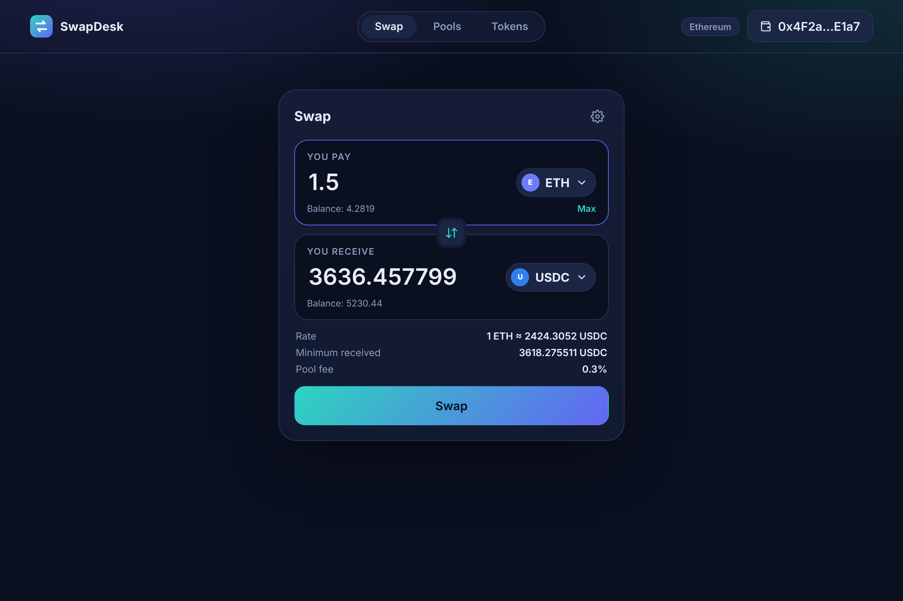
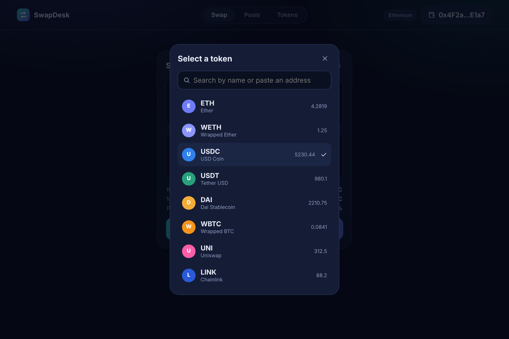
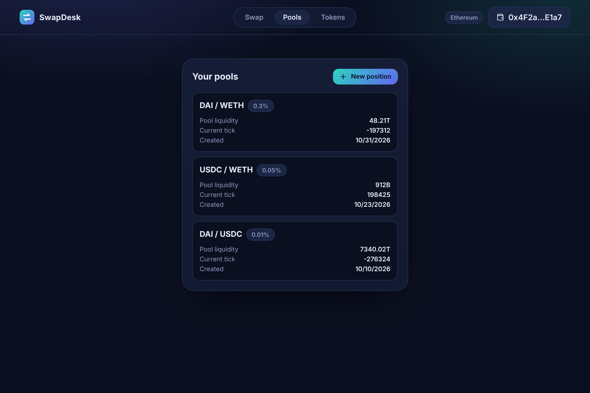
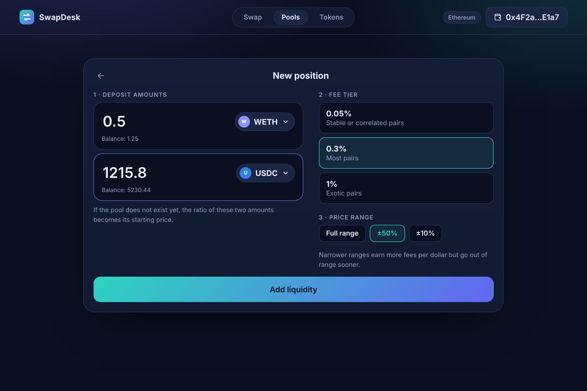
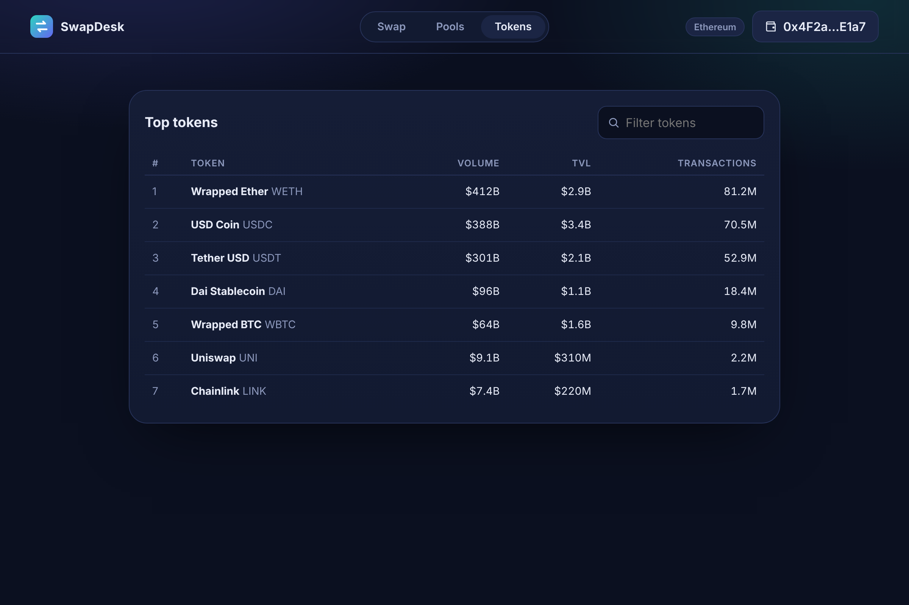
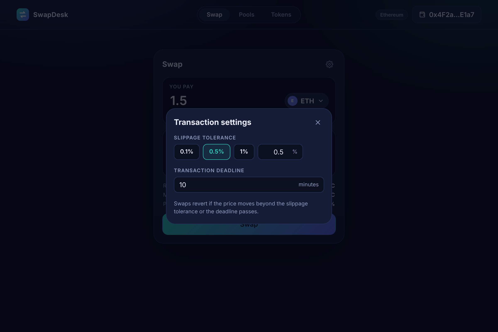
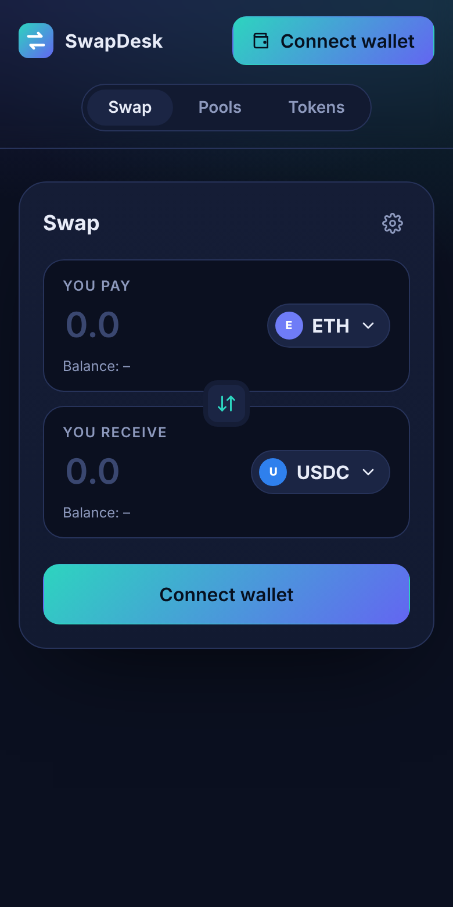
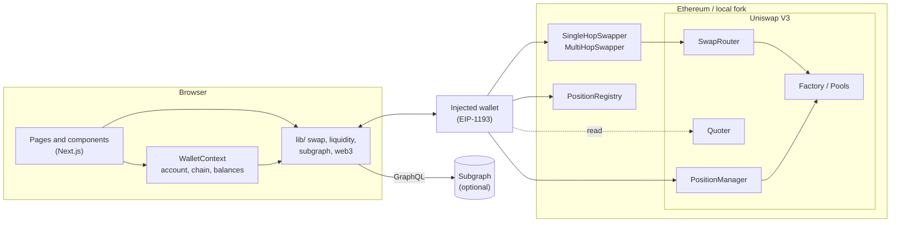
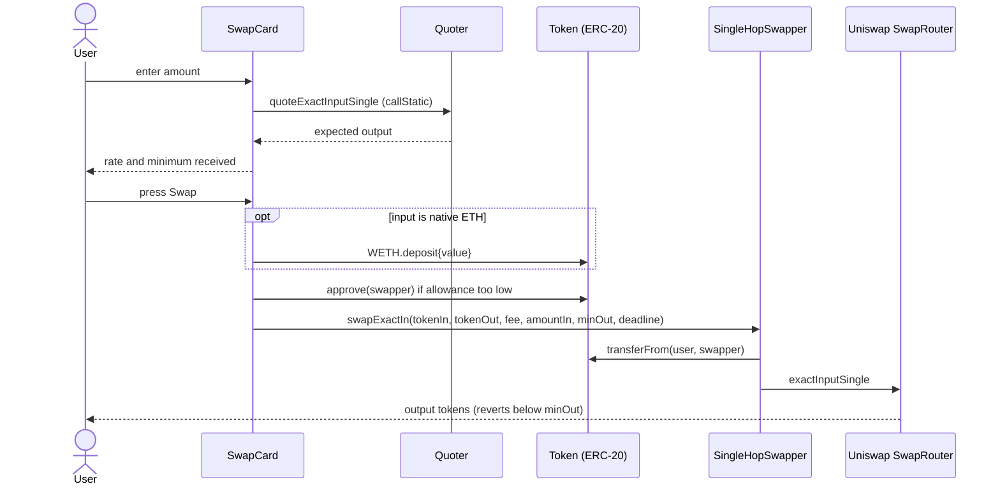
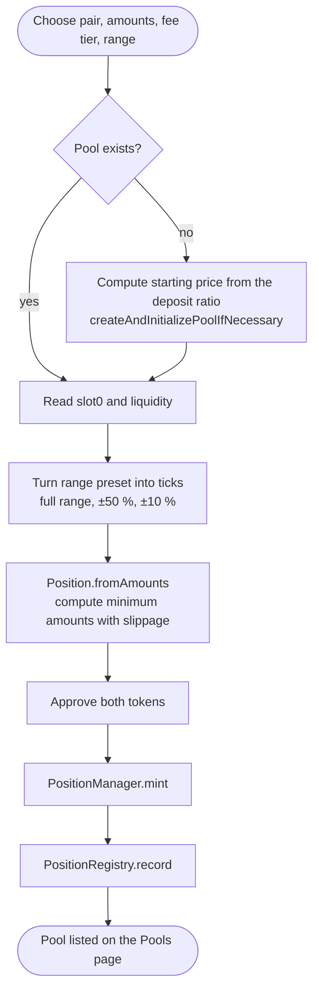

<div align="center">

# SwapDesk

**A Uniswap V3 swap and liquidity dashboard** — a Next.js front end backed by a small set of Hardhat smart contracts

`Next.js 13` · `ethers v5` · `Uniswap V3 SDK` · `Hardhat` · `Solidity 0.7.6`



</div>

---

## What it does

| Area | Capability |
| --- | --- |
| **Swap** | Live quotes from the on-chain Quoter, slippage and deadline controls, automatic ETH wrapping, minimum-received protection |
| **Pools** | Create a pool when it does not exist yet, then mint a concentrated-liquidity position with a fee tier and range preset |
| **Tokens** | Leaderboard of the most traded tokens read from a Uniswap V3 subgraph you configure |
| **Contracts** | Single-hop and multi-hop swappers, a position registry and a liquidity manager, all ready to deploy locally or on a fork |

## Screenshots

| Swap | Token picker |
| :---: | :---: |
|  |  |

| Pools | New position |
| :---: | :---: |
|  |  |

| Top tokens | Settings | Mobile |
| :---: | :---: | :---: |
|  |  |  |

## Architecture



## Core flows

### Swap



### Add liquidity



## Project structure

```text
swapdesk/
├── contracts/
│   ├── SingleHopSwapper.sol      # exact-in / exact-out through one pool
│   ├── MultiHopSwapper.sol       # routes across several pools
│   ├── LiquidityManager.sol      # holds position NFTs, mint / collect / decrease
│   ├── PositionRegistry.sol      # per-account list of created pools
│   ├── interfaces/IWETH.sol
│   └── tokens/DemoToken.sol      # configurable ERC-20 for local pools
├── scripts/deploy.js             # deploys the contracts and prints env values
├── test/                         # unit tests + optional mainnet-fork tests
├── src/
│   ├── config/                   # addresses, fee tiers, defaults (env driven)
│   ├── context/WalletContext.js  # account, chain, balances
│   ├── lib/                      # abis, web3, swap, liquidity, subgraph, formatting
│   ├── components/               # Header, SwapCard, TokenPicker, AddLiquidityForm, ...
│   ├── pages/                    # index (swap), pools, tokens
│   └── styles/globals.css        # design tokens and layout
├── docs/screenshots/
├── hardhat.config.js
└── .env.example
```

## Smart contracts

| Contract | Purpose | Notable details |
| --- | --- | --- |
| `SingleHopSwapper` | Swap through a single pool | `minAmountOut` and `deadline` are caller supplied; surplus input is refunded on exact-out |
| `MultiHopSwapper` | Swap along `tokens[]` with `fees[]` | Builds the packed path on-chain, reverses it for exact-out, validates route length |
| `LiquidityManager` | Custody of position NFTs for one pair | Only the depositor can collect or decrease; only the position manager can send NFTs |
| `PositionRegistry` | Remembers pools per account | `entriesOf(address)` is what the Pools page reads |
| `DemoToken` | Test ERC-20 | Name, symbol and supply are constructor arguments |

## Getting started

**Requirements:** Node.js 18+ and a browser wallet

```bash
# 1. install
npm install

# 2. configure
cp .env.example .env.local

# 3. start a local chain (optionally fork mainnet with FORK_RPC_URL set in your shell)
npx hardhat node

# 4. in a second terminal, deploy and copy the printed NEXT_PUBLIC_* values into .env.local
npm run deploy:local

# 5. run the app
npm run dev
```

Open <http://localhost:3000>, connect your wallet, and point it at the local network (`http://127.0.0.1:8545`, chain id `31337`)

> Swapping and quoting need real Uniswap V3 pools, so run the node as a **mainnet fork** or use a network where Uniswap V3 is deployed

## Configuration

All settings are environment variables; nothing sensitive lives in source.

| Variable | Used by | Description |
| --- | --- | --- |
| `NEXT_PUBLIC_SINGLE_HOP` | app | Address of `SingleHopSwapper` |
| `NEXT_PUBLIC_MULTI_HOP` | app | Address of `MultiHopSwapper` |
| `NEXT_PUBLIC_REGISTRY` | app | Address of `PositionRegistry` |
| `NEXT_PUBLIC_SUBGRAPH_URL` | app | Uniswap V3 subgraph endpoint for the Tokens page |
| `NEXT_PUBLIC_WETH`, `_FACTORY`, `_QUOTER`, `_POSITION_MANAGER` | app | Override the mainnet Uniswap addresses on other networks |
| `FORK_RPC_URL` | Hardhat | Your own RPC endpoint, enables fork tests |
| `SWAP_ROUTER` | deploy script | Router address override |

## Testing

```bash
npm test                              # unit tests (no network needed)
FORK_RPC_URL=<your-rpc> npm test      # also runs the mainnet-fork swap tests
```

## Security notes

- Keep RPC keys, API keys and private keys in `.env*` files, which are git-ignored. Never commit them
- The swappers accept a `minAmountOut`; the UI derives it from the live quote and your slippage setting
- The contracts are educational and **have not been audited**. Do not deploy them with real funds without a review
